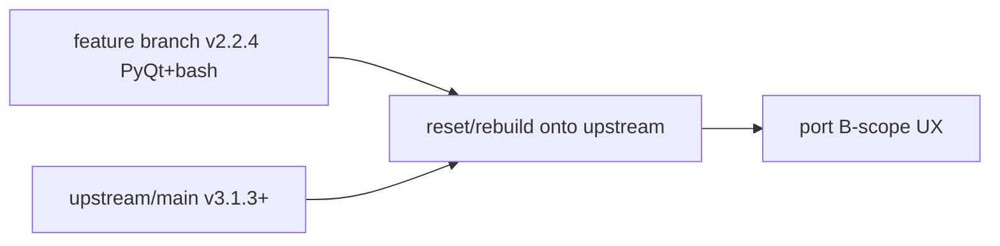

# Merge upstream v3.1.3+ and port fork UX

## Decisions (locked)

- **Target:** latest [`upstream/main`](https://github.com/idossha/TI-Toolbox) (`091c05da`, v3.1.3 + later fixes), not an intermediate v2.x tag.
- **Strategy:** rebuild the branch from upstream tip, then re-apply fork value. Do **not** continue conflict-resolving the old PyQt/`ti-toolbox/cli` tree through ~1992 commits.
- **Scope B:** after the catch-up, port command-history, copyable CLI/argv, and verify/fix console follow-tail + whole-head listing against the new UI.

## Why not a plain merge

[`feature/merge-from-upstream`](c:\Users\pho\repos\TI-Toolbox) is still ~**v2.2.4**. Upstream removed `tit/gui` (Electron [`desktop/`](desktop/)), replaced bash CLI with Python/`tit.jobs`, and renamed the image. Prior merge conflicts were concentrated in `README.md` + `tit/gui/*` — those paths are gone upstream. Inventory: [Local features inventory](25553b75-b225-46ea-b986-aca9eac8a383), topology: [Upstream delta analysis](75e67fef-7a01-42ea-bdc3-d8ccb0baea76).

## Phase 1 — Catch up the branch

1. Ensure working tree stays clean; note current tip `3b5cceb5` for recovery.
2. On `feature/merge-from-upstream`:
   - `git reset --hard upstream/main` (or equivalent: new branch from upstream, replace feature tip).
   - Re-add **fork-only developer files** that do not fight upstream:
     - [`.vscode/`](.vscode/), [`TI-Toolbox.code-workspace`](TI-Toolbox.code-workspace)
     - [`.github/copilot-instructions.md`](.github/copilot-instructions.md)
     - [`pho_test_run_script.sh`](pho_test_run_script.sh) (update hardcoded `ti-toolbox/...` paths to v3 layout / `tit` as needed)
     - Keep local `.python-version` / `uv.lock` only if they still match the v3 toolchain; otherwise drop or regenerate.
3. **Do not restore:** `ti-toolbox/cli/*.sh`, `tit/gui/**`, README Scratch/Pho TODO paste-bin, `.cursor/plans/*` whole-head plan artifact.
4. Smoke: desktop build/typecheck if practical; confirm `tit` imports and server starts against the new tree.

## Phase 2 — Map old features → v3 surfaces (then implement B)

| Fork feature | Upstream reality | Action |
|---|---|---|
| Console auto-scroll | [`desktop/src/renderer/ui/VirtualList.tsx`](desktop/src/renderer/ui/VirtualList.tsx) `followTail` + [`JobTerminal`](desktop/src/renderer/pages/_shared/run/JobTerminal.tsx) / `JobConsole` | **Verify** follow-tail (incl. `tests/e2e/terminal.spec.ts` if present). Patch only if stickiness/regressions remain. |
| Command history log + enable toggle | No equivalent | **Implement** under Settings → Project ([`desktop/src/renderer/pages/settings/index.tsx`](desktop/src/renderer/pages/settings/index.tsx) + settings API) and job start path in [`tit/jobs/`](tit/jobs/) (argv already built in `kinds.py` / run in `manager.py`): when enabled, append timestamped argv lines to `command_history.log` under the project dir (cwd fallback only if no project). |
| Copyable CLI when GUI/CLI runs | Job argv exists server-side; no “Copy command” UX found | **Implement** “Copy command” on job detail ([`JobDetailPane.tsx`](desktop/src/renderer/app/jobs-rail/JobDetailPane.tsx) / job status payload): shell-escaped argv from the job record. Prefer exposing `argv` (or a formatted command string) from the jobs API rather than resurrecting bash printers. |
| Whole-head nested NIfTI detection | Catalog walks for `analysis.json`+`results.csv` ([`tit/catalog.py`](tit/catalog.py) analyses discovery); Results labels `whole_head` | **Verify** Results/viewer listing for `whole_head_*` nested layouts. Port discovery only if nested outputs are still invisible. |
| Bash montage/sim-list / `coordinate_space` | Redesigned in catalog + Python analyzer/group flows | **Verify then drop** — no bash port. |
| Nibabel visualizer import fix | Upstream visualizer rewritten | **Re-check** analyze/visualize path; fix only if still broken. |
| Apptainer / DooD | Already upstream | **Nothing** |

### B-port implementation details

**Command history**

- Add a boolean preference (project or user settings — match existing Settings patterns in `pages/settings/api.ts` / server settings schema).
- On successful job admit/start in `tit/jobs/manager.py` (or the single place argv is finalized), if enabled, append one line: ISO time, job id/kind, shell-quoted argv.
- Desktop: Project settings checkbox mirroring old tooltip (“log toolbox process commands to `command_history.log` in the project directory”). Optional later: path picker; v1 keeps project-dir destination (matches what the old code actually did).

**Copyable command**

- Ensure job status/detail includes the executed argv (or reconstruct from `kinds.py` inputs).
- UI: button on job detail / run pane that copies a paste-ready command to the clipboard (Windows/macOS/Linux quoting via a small shared formatter, server-side preferred for one source of truth).

**Console**

- Confirm Follow is on by default for live job logs; fix only real regressions vs old `QTimer.singleShot` behavior.

**Whole-head**

- Exercise catalog `analyses` + Results preview for a `whole_head_*` tree; if NIfTIs nested under region subdirs without `analysis.json` at the parent are missed, extend discovery in `tit/catalog.py` (not PyQt `nifti_viewer_tab`).

## Phase 3 — Validation

- Manual: start a sim/analyze job → settings toggle writes `command_history.log`; Copy command pastes a runnable line; job console follows tail; whole-head analysis appears in Results if present in the project.
- Run focused tests touching jobs settings/API and any new formatter unit tests; desktop e2e terminal follow-tail if in-repo.
- Do **not** merge into `origin/main` until this branch is green; main is still ~v2.2.1.

## Out of scope

- Upstream PR of personal Scratch README / pho hard-coded subject paths.
- Resurrecting PyQt GUI or bash CLI as supported surfaces.
- Full desktop feature parity beyond the B items above.